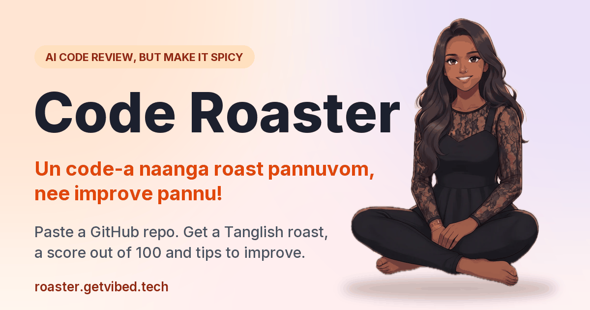
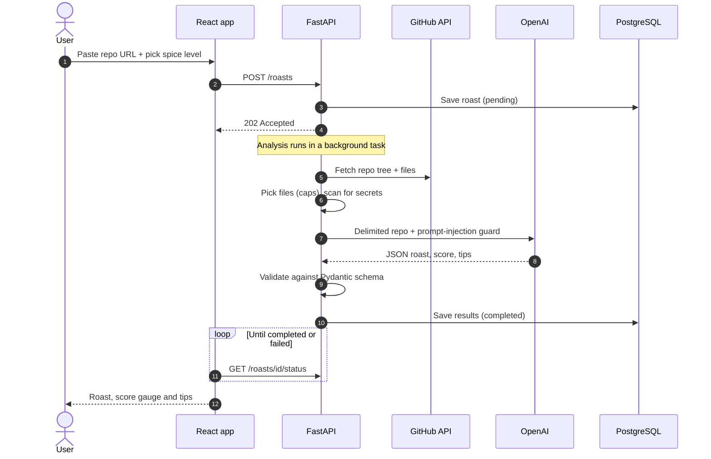
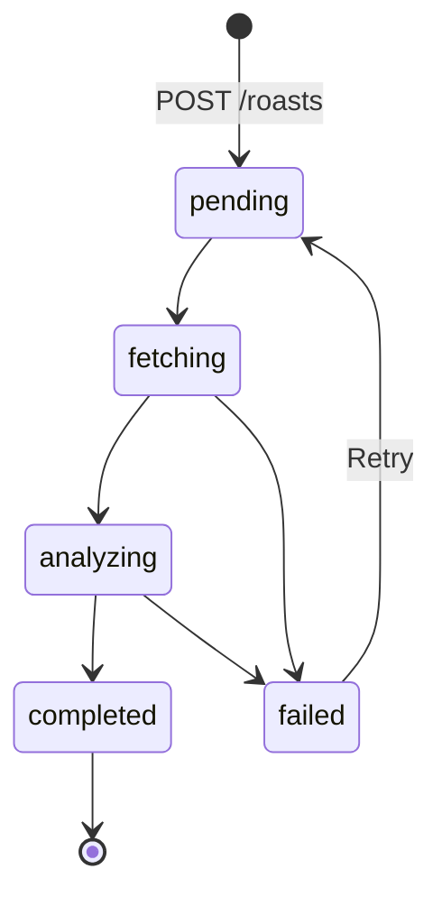
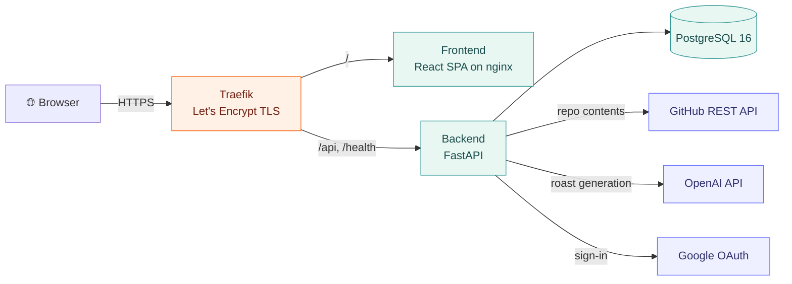
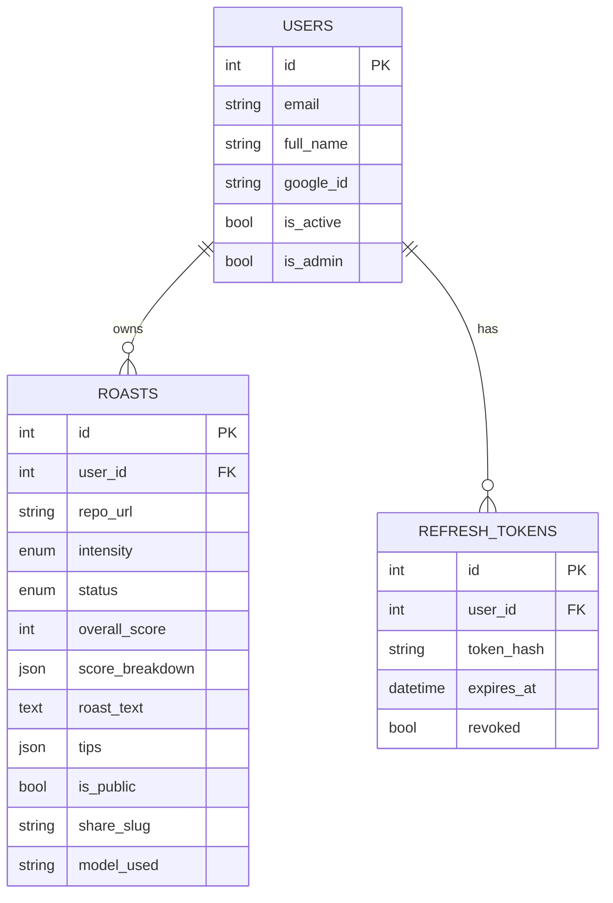
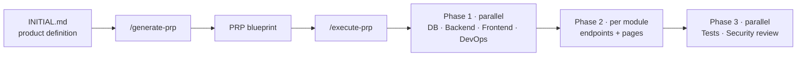

<div align="center">



# 🔥 Code Roaster

**We roast your code, you improve it!**
Paste a public GitHub repo. Get an honest (and spicy) **funny English** roast, a **score out of 100** and **tips to improve**.

<a href="https://roaster.getvibed.tech"></a>


[Features](#-features) · [How it works](#-how-it-works) · [Architecture](#-architecture) · [Tech stack](#-tech-stack) · [Run locally](#-run-locally) · [Deploy](#-deployment)

</div>

---

## ✨ Features

<table>
  <tr>
    <td width="33%" valign="top">
      <h3>🌶️ Three spice levels</h3>
      Mild, Medium or Extra Spicy. Only the <b>tone</b> changes. The score and tips stay the same.
    </td>
    <td width="33%" valign="top">
      <h3>📊 Score out of 100</h3>
      Five categories worth 20 each: code quality, structure, docs, AI best practices and security.
    </td>
    <td width="33%" valign="top">
      <h3>✅ Actionable tips</h3>
      3–7 prioritized tips in clear English, with a little humour.
    </td>
  </tr>
  <tr>
    <td valign="top">
      <h3>🔐 Secret checks</h3>
      Finds leaked API keys (always masked), a missing README and committed <code>.env</code> files.
    </td>
    <td valign="top">
      <h3>🔗 Shareable roasts</h3>
      Private by default. Share a public link with a social preview card.
    </td>
    <td valign="top">
      <h3>🛡️ Admin panel</h3>
      Users, roast moderation and platform stats, behind an admin-only guard.
    </td>
  </tr>
</table>

> Roasts target the **code, never the person**. Sign-in is **Google only**, so there are no passwords to forget.

---

## 🔄 How it works



### Roast status



---

## 🏗️ Architecture



### Data model



---

## 🧰 Tech stack

| Layer | Technology |
|:------|:-----------|
| **Frontend** | React 18 · TypeScript (strict) · Vite 8 · Chakra UI 2 · Framer Motion 14 · React Router 6 · Axios · react-markdown (sanitized) |
| **Backend** | FastAPI 0.143 · Uvicorn · Python 3.11+ · Pydantic 2 · slowapi (rate limits) · `httpx` · Pillow (share cards) |
| **Database** | PostgreSQL 16 · SQLAlchemy 2.1 · Alembic migrations · `psycopg` 3 |
| **Auth** | Google OAuth 2.0 · JWT (HS256) · refresh tokens stored hashed |
| **AI** | OpenAI Python SDK (`gpt-4o-mini` by default), output validated by Pydantic |
| **Infra** | Docker Compose · nginx · Traefik + Let's Encrypt · Ubuntu 24.04 VPS · `rsync` deploys |
| **Quality** | pytest · respx · ruff · mypy · Vitest · Testing Library · oxlint · GitHub Actions CI |

<details>
<summary><b>📈 Quality numbers</b></summary>

- Backend: **261 tests**, about **98% coverage** (CI gate is 80%).
- Frontend: **167 tests**, strict TypeScript with no `any`.
- GitHub and OpenAI are always mocked in tests.

</details>

<details>
<summary><b>🛡️ Security design</b></summary>

- The repo URL must match `^https://github\.com/[A-Za-z0-9-]+/[A-Za-z0-9._-]+/?$`, and the backend only talks to `api.github.com` and `raw.githubusercontent.com`.
- Repo contents go to the model between `<repo>` tags, and the system prompt says to treat them as untrusted data.
- The model's output is never trusted. It is validated, and the score must equal the sum of the five categories.
- Detected secrets are masked (`sk-...abcd`) and never logged or repeated in full.
- Public endpoints never return an email or user ID. Share slugs are random, not derived from the roast ID.

</details>

---

## 🚀 Run locally

```bash
cp .env.example .env     # fill in Google, OpenAI and secret values
docker compose up -d --build
```

Open **http://localhost:3000** · API docs at **http://localhost:8000/docs**

<details>
<summary><b>🔧 Hot reload and running without Docker</b></summary>

```bash
# Hot reload (http://localhost:5173)
docker compose -f docker-compose.dev.yml up --build

# Backend without Docker
cd backend
python -m venv .venv && source .venv/bin/activate
pip install -r requirements-dev.txt
alembic upgrade head
uvicorn app.main:app --reload

# Frontend (new terminal)
cd frontend && npm install && npm run dev
```

</details>

<details>
<summary><b>⚙️ Configuration</b></summary>

| Variable | Purpose |
|:---------|:--------|
| `DATABASE_URL` | PostgreSQL connection string |
| `SECRET_KEY` | JWT signing key (use a long random value) |
| `ADMIN_EMAILS` | Comma-separated emails that get the admin role |
| `GOOGLE_CLIENT_ID` / `GOOGLE_CLIENT_SECRET` | Google OAuth credentials |
| `GOOGLE_REDIRECT_URI` | Must be an authorized redirect URI in your Google OAuth client |
| `OPENAI_API_KEY` / `OPENAI_MODEL` | OpenAI access and model |
| `GITHUB_TOKEN` | Optional. Raises the GitHub rate limit from 60 to 5000 requests/hour |
| `MAX_FILES_ANALYZED` / `MAX_TOTAL_CHARS` | Caps on what is sent to the model |
| `DAILY_ROAST_LIMIT` | Roasts per user per rolling 24 hours (default 10, `0` = unlimited, admins exempt) |

**Never commit a real `.env`.** See `.env.example` and `.env.production.example`.

</details>

<details>
<summary><b>🧪 Tests and checks</b></summary>

```bash
cd backend  && ruff check . && mypy app && pytest --cov=app --cov-fail-under=80
cd frontend && npm run lint && npm run type-check && npm test && npm run build
```

</details>

---

## 📦 Deployment

Runs on a single VPS with Docker Compose. Full guide: [`deploy/README.md`](deploy/README.md).

```bash
# VPS already running Traefik (no host nginx)
PROXY=traefik DEPLOY_HOST=<VPS_IP> ./deploy/deploy.sh
```

---

## 🧱 Built with Claude Code

This app was generated from the MicroSaaS Template: **Clone → Define → Build.**



| File / folder | Purpose |
|:--------------|:--------|
| `INITIAL.md` | Product definition |
| `PRPs/code-roaster-prp.md` | Implementation blueprint |
| `CLAUDE.md` | Project rules |
| `skills/` · `agents/` · `.claude/commands/` | Code patterns, agent definitions and custom commands |

---

<div align="center">

Made with 🔥 and a lot of humour.

</div>
